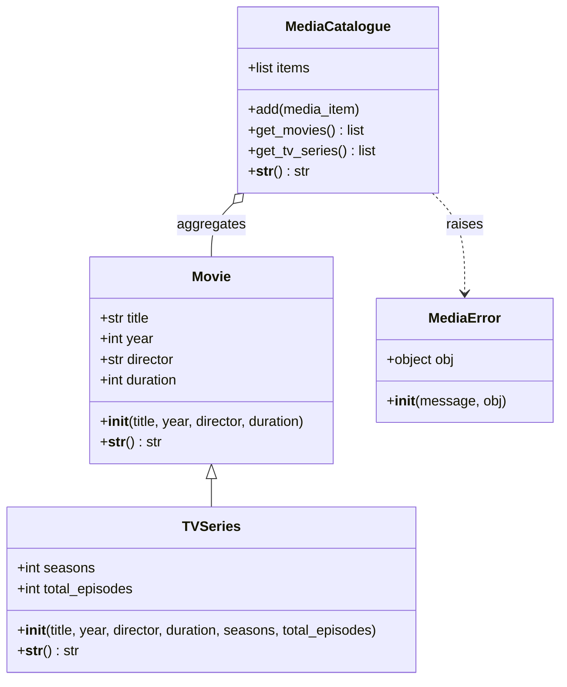

# freeCodeCamp Python v9 Archive

Repository containing solutions, workshops, and lab implementations for the [freeCodeCamp Python v9 Curriculum](https://www.freecodecamp.org/learn/python-v9/).

All programs are implemented using Python's standard library without external dependencies, emphasizing clean code, idiomatic Python syntax, robust input validation, and object-oriented principles.

## Curriculum Modules

| File | Type | Exercise | Key Concepts & Techniques |
| --- | --- | --- | --- |
| `caesar_cipher.py` | Workshop | Build a Caesar Cipher | String slicing, translation tables (`str.maketrans`), symmetric cipher logic, shift validation |
| `character_creator.py` | Lab | Build an RPG Character | Visual ASCII bars, stat constraints, collection validation (`all()`), formatted strings |
| `pin_extractor.py` | Workshop | Build a PIN Extractor | Multiline text parsing, `enumerate()`, nested loops, boundary checks, index-based string length extraction |
| `number_pattern_generator.py` | Lab | Build a Number Pattern Generator | Range iteration, argument validation, delimiter formatting, string accumulation |
| `medical_data_validator.py` | Workshop | Build a Medical Data Validator | Schema validation, regex matching (`re.fullmatch`), set comparison, dictionary unpacking |
| `musical_instrument_inventory.py` | Workshop | Build a Musical Instrument Inventory | OOP fundamentals, class constructors (`__init__`), instance state, encapsulated behavior |
| `media_catalogue.py` | Workshop | Build a Media Catalogue | OOP inheritance, `super()`, custom exceptions (`MediaError`), type filtering, string representations |

## Module Architecture

The following diagram illustrates the object-oriented structure implemented in `media_catalogue.py`:



## Module Specifications

### 1. Caesar Cipher (`caesar_cipher.py`)
Implements bidirectional Caesar cipher cryptography (encryption and decryption) using alphabet slicing and `str.maketrans` translation tables.

| Component | Signature | Description |
| --- | --- | --- |
| `caesar` | `(text: str, shift: int, encrypt: bool = True) -> str` | Core cipher logic. Validates shift interval `[1, 25]` and shifts both lowercase and uppercase characters. |
| `encrypt` | `(text: str, shift: int) -> str` | Convenience wrapper for encryption. |
| `decrypt` | `(text: str, shift: int) -> str` | Convenience wrapper for decryption using inverted shift. |

### 2. RPG Character Creator (`character_creator.py`)
Validates starting character configurations against strict point-budget rules and renders visual progress bars (`●` and `○`).

| Rule / Field | Constraint | Description |
| --- | --- | --- |
| Name | String, non-empty, length <= 10, no spaces | Character name validation |
| Stats | Integers in range `[1, 4]` | Applied across Strength, Intelligence, and Charisma |
| Point Total | Sum of all stats must equal 7 | Total starting stat pool limit |
| Output | Multi-line formatted stats block | Displays visual 10-point gauge bars |

### 3. PIN Extractor (`pin_extractor.py`)
Extracts variable-length numerical pins embedded inside poetry stanzas by calculating the length of the *n*-th word located on line *n*.

| Feature | Implementation Detail |
| --- | --- |
| Parser | Splits poems on newline characters (`\n`) and whitespace |
| Extraction Rule | Line index `i` inspects word at index `i`; appends word character count |
| Fallback Rule | Appends `'0'` when line length has fewer than `i + 1` words |

### 4. Number Pattern Generator (`number_pattern_generator.py`)
Generates single-line sequential number chains separated by spaces for positive integers.

| Parameter | Constraints | Return Value |
| --- | --- | --- |
| `n` | `int`, `n >= 1` | Space-separated string `'1 2 ... n'` |
| Invalid inputs | Non-integer or `n < 1` | Descriptive validation error message |

### 5. Medical Data Validator (`medical_data_validator.py`)
Performs schema validation against collections of patient medical records.

| Field | Validation Constraint |
| --- | --- |
| `patient_id` | Case-insensitive regex `r'p\d+'` |
| `age` | Integer `>= 18` |
| `gender` | Case-insensitive string matching `'male'` or `'female'` |
| `diagnosis` | String or `None` |
| `medications` | List of string items |
| `last_visit_id` | Case-insensitive regex `r'v\d+'` |

### 6. Musical Instrument Inventory (`musical_instrument_inventory.py`)
Demonstrates object-oriented initialization, attributes, and instance methods for instrument categorization.

| Method | Behavior |
| --- | --- |
| `play()` | Outputs instrument sound performance message |
| `get_fact()` | Returns formatted string describing family classification |

### 7. Media Catalogue (`media_catalogue.py`)
Comprehensive OOP implementation demonstrating class inheritance, method overriding, custom exception handling, and collection management.

| Class | Responsibilities |
| --- | --- |
| `MediaError` | Custom exception capturing message and triggering invalid object reference |
| `Movie` | Base entity storing title, year (`>= 1895`), director, and duration (`> 0`) |
| `TVSeries` | Derived class extending `Movie` with `seasons` (`>= 1`) and `total_episodes` (`>= 1`) |
| `MediaCatalogue` | Collection supporting polymorphically adding media, strict type filtering, and multi-section text rendering |

## Execution Guide

### Prerequisites
- Python 3.10+ (Standard Library only)
- Optional: `uv` package manager

### Running Scripts

Execute scripts directly using standard Python:

```bash
python3 caesar_cipher.py
python3 character_creator.py
python3 pin_extractor.py
python3 number_pattern_generator.py
python3 medical_data_validator.py
python3 musical_instrument_inventory.py
python3 media_catalogue.py
```

Or using `uv`:

```bash
uv run python caesar_cipher.py
```

## Curriculum Progress

### Python v9

- [x] Build a Caesar Cipher
- [x] Build an RPG Character
- [x] Build a PIN Extractor
- [x] Build a Number Pattern Generator
- [x] Build a Medical Data Validator
- [x] Build a Musical Instrument Inventory
- [x] Build a Media Catalogue
- [ ] Remaining Python v9 curriculum
